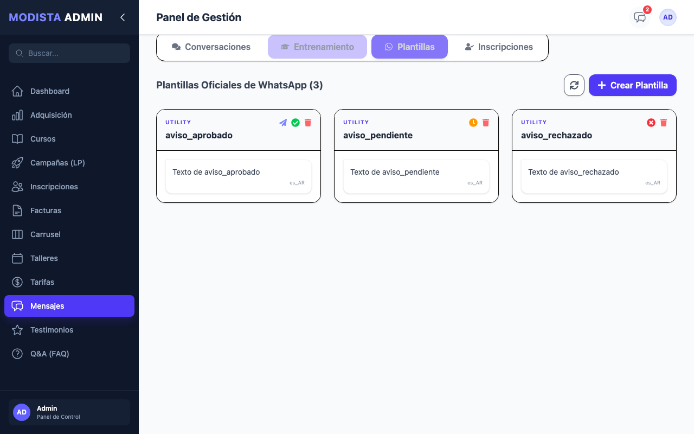
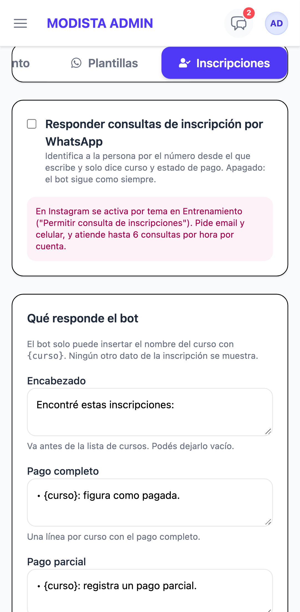
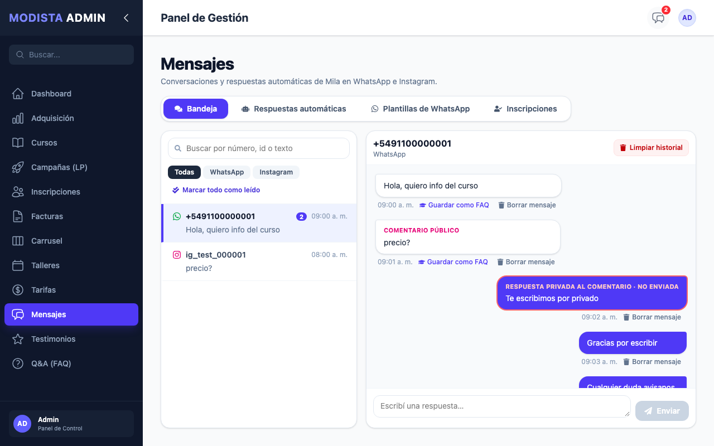
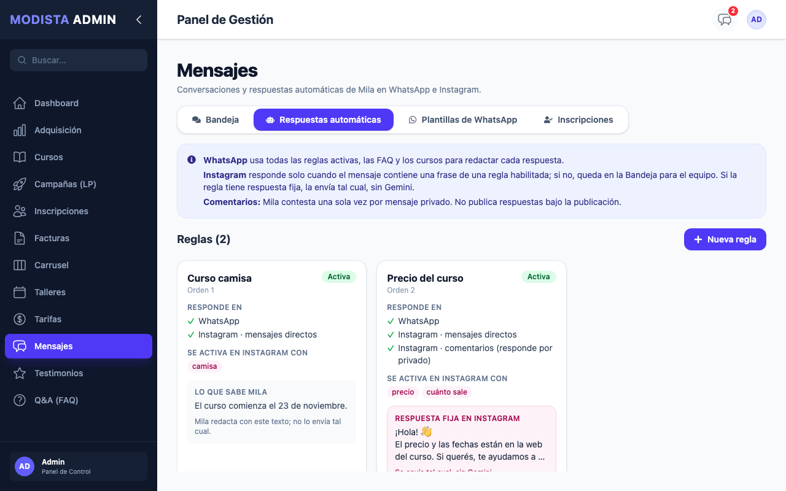
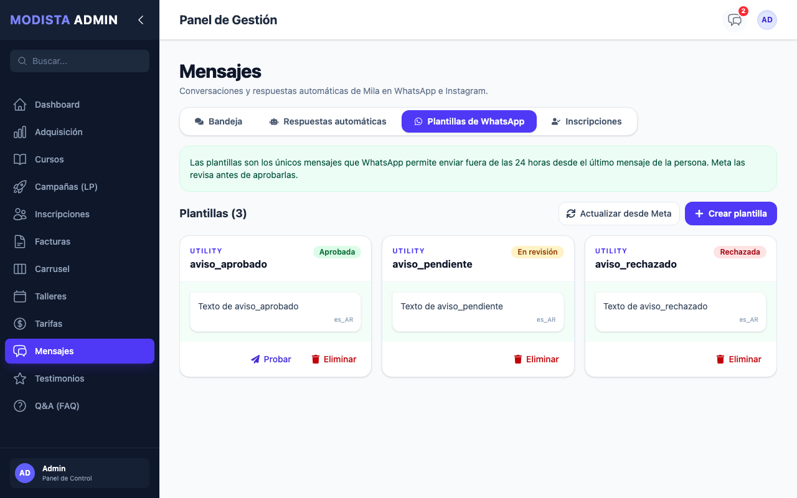
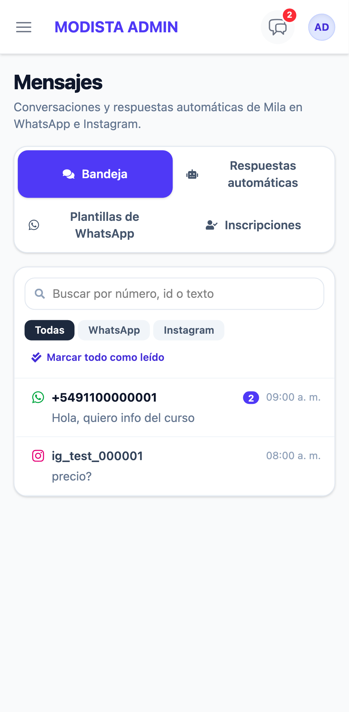
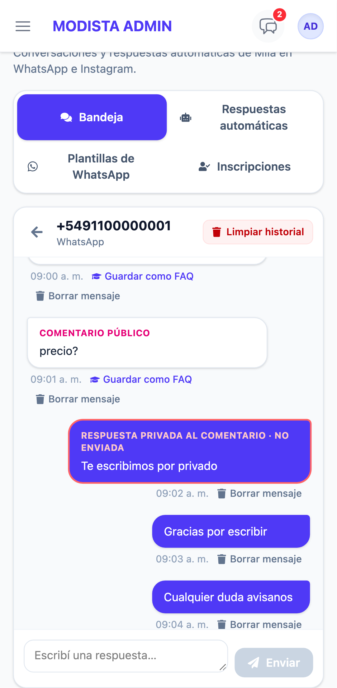
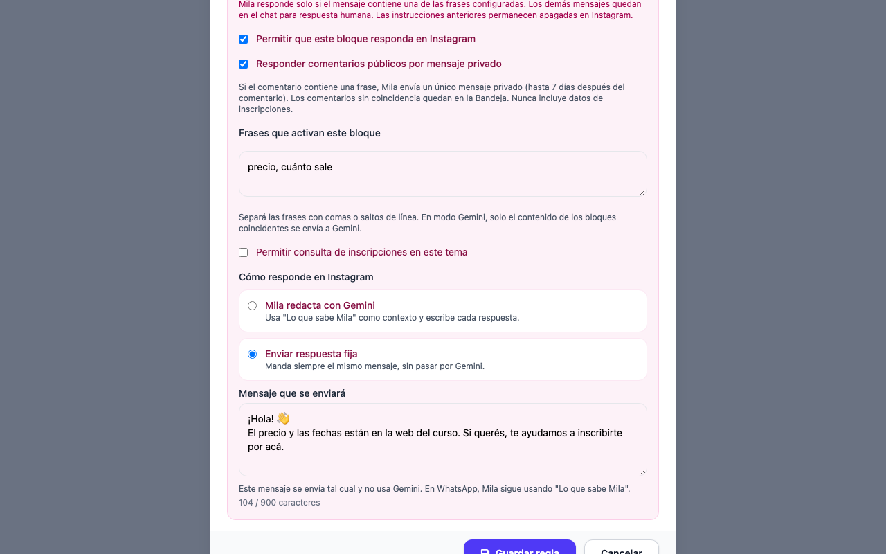
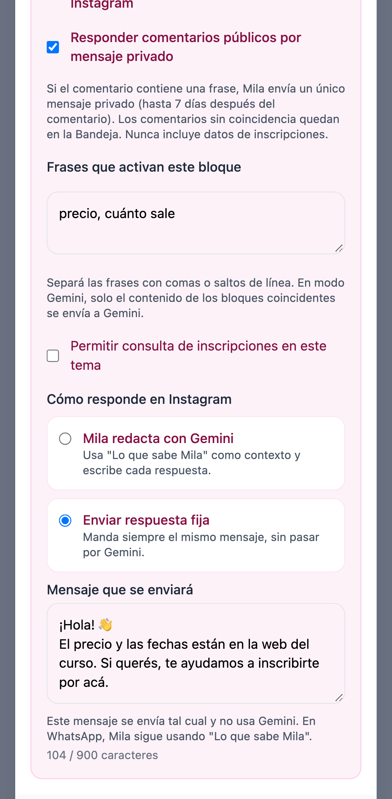

# Guía: sección Mensajes (`/admin/chat`)

Cómo funciona la sección, qué cambió en cada PR y cómo se ve. Datos de las capturas: ficticios.

## Cómo funciona

| Pestaña (antes) | Para qué sirve | De dónde salen los datos |
|---|---|---|
| Bandeja (Conversaciones) | Ver y responder chats de WhatsApp e Instagram. Búsqueda, filtro por canal, marcar todo leído, borrar mensaje, limpiar historial, "Guardar como FAQ". | `GET /api/chat` cada 10 s (pausa con la pestaña del navegador oculta); mensajes al abrir un chat. |
| Respuestas automáticas (Entrenamiento) | Reglas que Mila usa como **contexto** para redactar (no se envían textualmente). | `/api/chat/instructions` |
| Plantillas de WhatsApp (Plantillas) | Plantillas oficiales: estado en Meta, crear, borrar, enviar prueba (solo aprobadas). | `/api/notifications/whatsapp/templates` |
| Inscripciones | Interruptor de consulta por WhatsApp y textos de respuesta con vista previa. | `/api/chat/enrollment-config` |

### Qué responde Mila automáticamente

- **WhatsApp:** usa todos los bloques activos, más FAQ y cursos.
- **Instagram (mensaje directo):** solo si la regla tiene "Permitir que este bloque responda en Instagram" y una de sus frases aparece en el mensaje. Si nada coincide, el mensaje queda para el equipo.
- **Instagram (comentario):** solo si la regla tiene "Responder comentarios públicos por mensaje privado" y coincide una frase. La respuesta va **por mensaje privado**, una vez por comentario. No hay respuesta pública bajo la publicación.
- **Respuesta fija (opcional por regla):** en "Cómo responde en Instagram" se elige "Enviar respuesta fija" y se escribe el "Mensaje que se enviará". Cuando coincide una frase, ese texto sale tal cual, sin Gemini (en DM y en la respuesta privada a comentarios). Si coinciden varias reglas fijas gana la de menor orden; una regla fija gana sobre las de Gemini. Una regla fija puede tener también la consulta de inscripciones: en mensajes directos, las preguntas sobre el estado de una inscripción usan la consulta y las demás reciben el texto fijo. En WhatsApp nada cambia: Mila usa "Lo que sabe Mila".
- Las frases no distinguen mayúsculas ni acentos y buscan el inicio de palabra: "curso" también activa con "cursos".

### Límites que la pantalla no puede saltear

- Un comentario no habilita responder a mano: hace falta que la persona escriba un mensaje directo.
- El único estado de envío confiable es "no enviada"; el sistema no informa "entregado" ni "leído".
- No hay indicador de conexión con Meta ni métricas del bot: el API no los entrega.

## PR 1: red de seguridad

Sin cambios visuales. Agrega pruebas que fijan el comportamiento y las llamadas actuales, para que el rediseño no rompa nada sin que se note:

- 41 pruebas de página y pestañas: flujos, confirmaciones, errores, polling, doble envío (`npm test`).
- 17 pruebas de contrato HTTP: ruta, método y cuerpo de cada llamada de la sección, incluida "Entrenar Mila" (`src/services/**/*.test.ts`).
- 14 pruebas en navegador real en PR 1 (16 en PR 2, con el borrado usando el diálogo real), escritorio y móvil. El API es simulado: cualquier llamada nueva o cambiada hace fallar el test, y nada sale a internet (`npm run test:e2e`).
- 8 defectos conocidos quedan anotados como `it.todo`; el PR 2 los convierte en pruebas rojas y los corrige.
- Revisión con 6 agentes (`.ai-review/`); el informe está en `.ai-review/reports/`.

Pruebas que el PR 2 puede ajustar sin cambiar comportamiento (selectores marcados `TEMP`): tarjeta de plantilla por clase `.group`, botón borrar plantilla por posición, botones "volver" y "enviar" sin nombre accesible.

| Comando | Qué verifica |
|---|---|
| `npm test` | Unitarias y de contrato |
| `npm run test:e2e` | Navegador real, escritorio y móvil |
| `npm run test:coverage` | Cobertura |
| `npm run typecheck` | Tipos (e2e primero; `src` arrastra 48 errores previos, ninguno en bot-message) |
| `SCREENSHOTS=<carpeta> npm run test:e2e -- screenshots` | Capturas para esta guía |

### Pantallas antes del rediseño

| Escritorio | Móvil |
|---|---|
|  |  |
|  |  |
|  |  |
|  |  |
|  |  |

Problemas encontrados que corrige el PR 2:

- En móvil las pestañas "Plantillas" e "Inscripciones" quedan fuera de pantalla.
- "Borrar" y "Entrenar Mila" solo aparecen al pasar el mouse: no funcionan con el dedo.
- Botones sin nombre accesible ("volver", "enviar", "borrar plantilla").
- Si el API devuelve datos incompletos en una pestaña, el panel entero queda en blanco.
- Cambiar de chat mientras carga puede mostrar mensajes del chat anterior.
- La vista previa de plantillas carga una imagen de fondo desde GitHub.

## PR 2: rediseño

Misma ruta, mismos servicios, mismos payloads: lo prueban las 17 pruebas de contrato y el e2e, que falla ante cualquier llamada nueva. Cambia la presentación y se corrigen los 8 defectos anotados (cada uno con prueba roja primero).

### Qué cambia para quien opera

| Antes | Ahora |
|---|---|
| "Mila AI" con pestañas Conversaciones / Entrenamiento / Plantillas | "Mensajes" con Bandeja / Respuestas automáticas / Plantillas de WhatsApp / Inscripciones, las 4 visibles en el celular |
| Lista sin búsqueda | Búsqueda local por número, id o texto (no pide nada nuevo al servidor) |
| "Borrar" y "Entrenar Mila" solo con el mouse | "Borrar mensaje" y "Guardar como FAQ" siempre visibles |
| Responder a un chat de Instagram con solo comentarios fallaba | El campo explica que hace falta un mensaje directo y se deshabilita |
| Cambiar de chat rápido podía mostrar mensajes del anterior | Se descartan respuestas viejas |
| Bloques técnicos de instrucción | Tarjetas de regla: dónde responde, qué frase la activa y "Mila redacta con este texto; no lo envía tal cual" |
| `window.confirm` / `window.prompt` | Diálogos propios; la prueba de plantilla avisa que es un mensaje real |
| Error de carga = lista vacía | Error con "Reintentar", distinto de "no hay datos" |
| Una pestaña rota dejaba el panel en blanco | Mensaje de error solo en esa pestaña |
| "Todos los mensajes marcados como leídos" aunque no hubiera ninguno | "No había mensajes sin leer" |

### Antes y después

| Antes | Después |
|---|---|
|  |  |
|  |  |
|  |  |
|  |  |
|  |  |

### Sigue fuera de alcance (requiere cambios de API)

Respuesta pública bajo la publicación, elegir publicación, prioridad entre reglas, palabras clave en WhatsApp, estado de conexión con Meta, métricas del bot, estados "entregado/leído" y el doble guardado del envío manual de WhatsApp (`api/controllers/chat/chatController.ts:80`).

## Respuesta fija en Instagram

Misma ruta y mismos servicios; el formulario agrega dos campos (`instagramResponseMode`, `instagramFixedResponse`) que la API nueva valida. Las reglas existentes quedan en "Mila redacta con Gemini".

| Formulario de la regla | En el celular |
|---|---|
|  |  |

La tarjeta de la regla muestra "Respuesta fija en Instagram" con el texto y "Se envía tal cual, sin Gemini" (ver `screens/despues/desktop-3-respuestas.png`).

