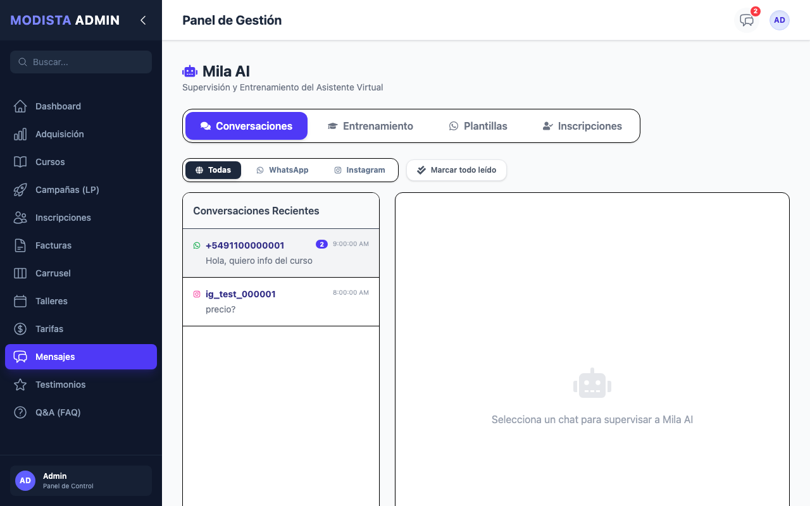
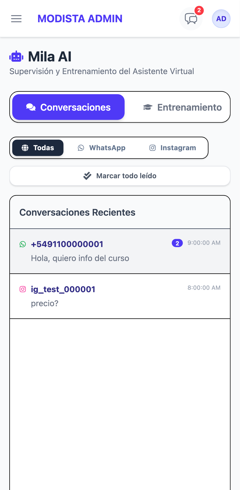
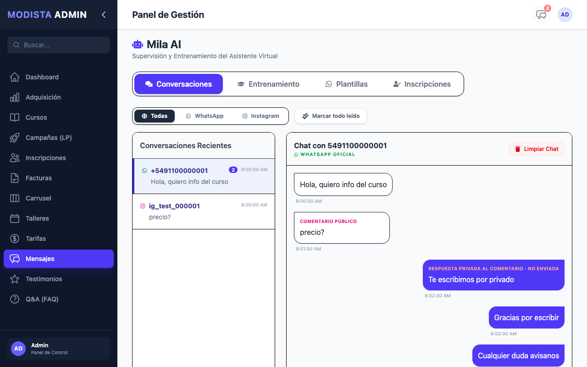
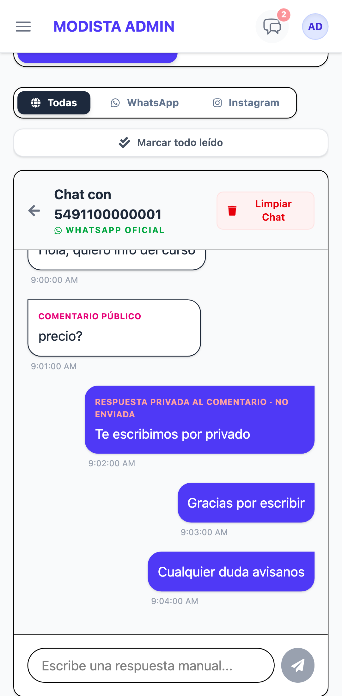
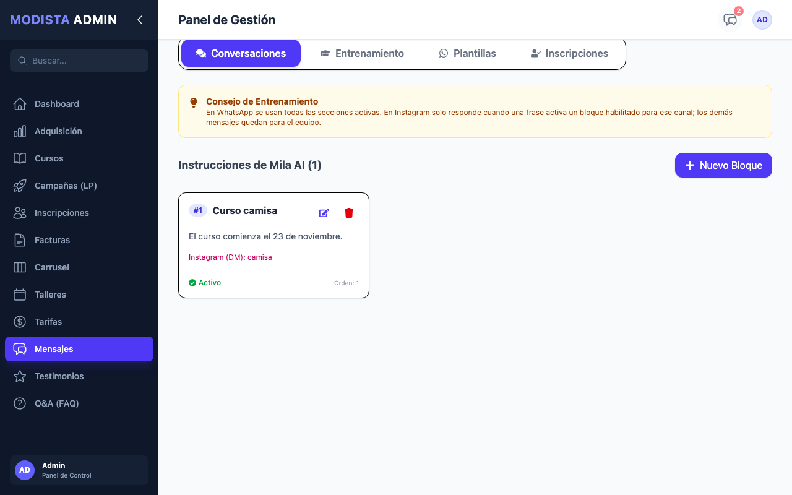
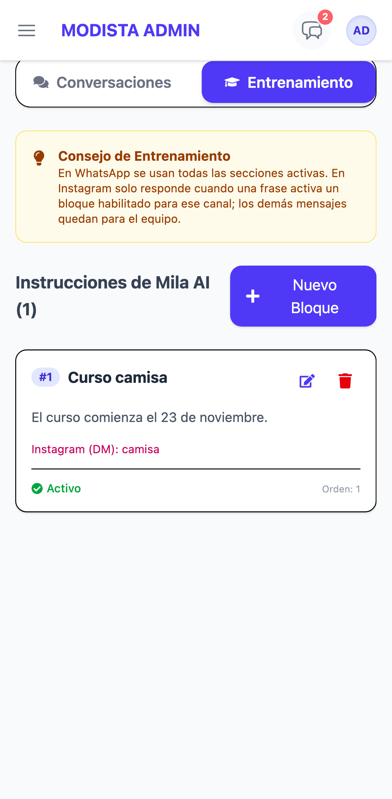
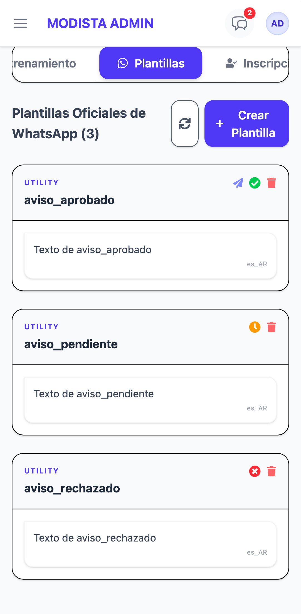
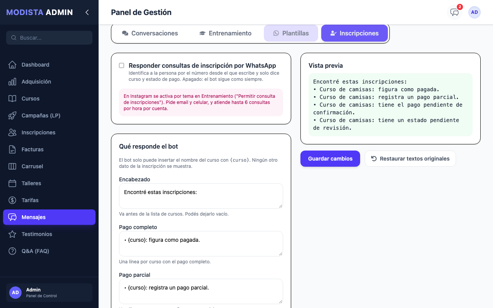

# Guía: sección Mensajes (`/admin/chat`)

Cómo funciona hoy la sección, qué fija cada PR y cómo se ve. Datos de las capturas: ficticios.

## Cómo funciona

| Pestaña | Para qué sirve | De dónde salen los datos |
|---|---|---|
| Conversaciones | Ver y responder chats de WhatsApp e Instagram. Filtro por canal, marcar todo leído, borrar mensaje, limpiar historial, "Entrenar Mila" (crea una FAQ). | `GET /api/chat` cada 10 s; mensajes al abrir un chat. |
| Entrenamiento | Bloques de instrucciones que Mila usa como **contexto** para redactar (no se envían textualmente). | `/api/chat/instructions` |
| Plantillas | Plantillas oficiales de WhatsApp: estado en Meta, crear, borrar, enviar prueba (solo aprobadas). | `/api/notifications/whatsapp/templates` |
| Inscripciones | Interruptor de consulta por WhatsApp y textos de respuesta con vista previa. | `/api/chat/enrollment-config` |

### Qué responde Mila automáticamente

- **WhatsApp:** usa todos los bloques activos, más FAQ y cursos.
- **Instagram (mensaje directo):** solo si el bloque tiene "Responder en Instagram" y una de sus frases aparece en el mensaje. Si nada coincide, el mensaje queda para el equipo.
- **Instagram (comentario):** solo si el bloque tiene "Responder comentarios" y coincide una frase. La respuesta va **por mensaje privado**, una vez por comentario. No hay respuesta pública bajo la publicación.
- Las frases no distinguen mayúsculas ni acentos y buscan el inicio de palabra: "curso" también activa con "cursos".

### Límites que la pantalla no puede saltear

- Un comentario no habilita responder a mano: hace falta que la persona escriba un mensaje directo.
- El único estado de envío confiable es "no enviada"; el sistema no informa "entregado" ni "leído".
- No hay indicador de conexión con Meta ni métricas del bot: el API no los entrega.

## PR 1: red de seguridad (este PR)

Sin cambios visuales. Agrega pruebas que fijan el comportamiento y las llamadas actuales, para que el rediseño no rompa nada sin que se note:

- 41 pruebas de página y pestañas: flujos, confirmaciones, errores, polling, doble envío (`npm test`).
- 17 pruebas de contrato HTTP: ruta, método y cuerpo de cada llamada de la sección, incluida "Entrenar Mila" (`src/services/**/*.test.ts`).
- 14 pruebas en navegador real (7 escenarios × escritorio y móvil). El API es simulado: cualquier llamada nueva o cambiada hace fallar el test, y nada sale a internet (`npm run test:e2e`).
- 8 defectos conocidos quedan anotados como `it.todo`; el PR 2 los convierte en pruebas rojas y los corrige.
- Revisión con 6 agentes (`.ai-review/`); el informe está en `.ai-review/reports/`.

Pruebas que el PR 2 puede ajustar sin cambiar comportamiento (selectores marcados `TEMP`): tarjeta de plantilla por clase `.group`, botón borrar plantilla por posición, botones "volver" y "enviar" sin nombre accesible.

| Comando | Qué verifica |
|---|---|
| `npm test` | Unitarias y de contrato |
| `npm run test:e2e` | Navegador real, escritorio y móvil |
| `npm run test:coverage` | Cobertura |
| `npm run typecheck` | Tipos (e2e primero; `src` arrastra 52 errores previos) |
| `SCREENSHOTS=<carpeta> npm run test:e2e -- screenshots` | Capturas para esta guía |

### Pantallas actuales

| Escritorio | Móvil |
|---|---|
|  |  |
|  |  |
|  |  |
|  |  |
|  |  |

Problemas encontrados que corrige el PR 2:

- En móvil las pestañas "Plantillas" e "Inscripciones" quedan fuera de pantalla.
- "Borrar" y "Entrenar Mila" solo aparecen al pasar el mouse: no funcionan con el dedo.
- Botones sin nombre accesible ("volver", "enviar", "borrar plantilla").
- Si el API devuelve datos incompletos en una pestaña, el panel entero queda en blanco.
- Cambiar de chat mientras carga puede mostrar mensajes del chat anterior.
- La vista previa de plantillas carga una imagen de fondo desde GitHub.

## PR 2: rediseño (pendiente)

Se completará con las capturas nuevas y el antes/después.
